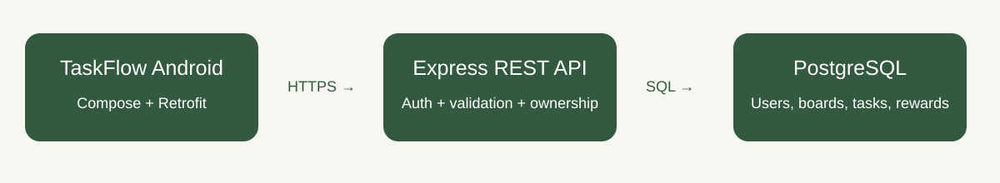

# TaskFlow Final Assessment Build

**Student number: ST10461820**  
A Kotlin Android Kanban app based on the submitted TaskFlow Part 1 plan, with task image attachments added for the final assessment.

TaskFlow turns student work into manageable cards that move through **To-do → Doing → Done**. This Kotlin/Jetpack Compose prototype follows the supplied Part 1 plan.

## Submission status

The source ZIP supplied for this update contains the Android app, REST API, PostgreSQL schema, automated workflow and Part 2 evidence. The earlier README reported that the API and PostgreSQL database were deployed on Render on 22 September 2026. Its free database was scheduled to expire on 22 October 2026; the current hosted service and its data have not been verified. The earlier README also reports a successful physical-phone test and passing GitHub Actions run #2; these are historical Part 2 results, not verification of this final assessment build.

This update adds task image upload, listing, preview and deletion through the authenticated API. Images are binary blobs stored in PostgreSQL, with a 5 MB limit and JPEG, PNG or WebP validation. ObjectBox stores a device-local NoSQL workspace snapshot and a queue of offline task changes; those changes sync through the existing API when connectivity returns. See [release notes](docs/RELEASE_NOTES.md).

The NoSQL requirement is implemented with ObjectBox on the phone. The hosted REST API and account data continue to use the existing PostgreSQL backend. This keeps the existing Render design while demonstrating NoSQL storage and reads locally. Task images are stored as PostgreSQL binary blobs; a separate cloud object-storage service is not configured. Final phone video, release signing, Play Console evidence, and current hosting status still need to be completed and checked. Google sign-in, push notifications and Afrikaans/isiZulu remain PoE-only features and are not implemented in this build.

## Hosted API

API: https://taskflow-api-ov2b.onrender.com/
Health check: https://taskflow-api-ov2b.onrender.com/health

For an existing installation, sign out and enter the API URL above in **Server connection**. Create a new account: local accounts were not migrated. The free service can take about a minute to wake after inactivity. The free database was scheduled to expire on **22 October 2026**; its current status has not been verified. This deployment used the public repository URL, so check/manual-deploy future code updates in Render.

## Demonstration video

[Watch the TaskFlow Part 2 demonstration](https://youtu.be/mKR7O_tKUn0).

## Features

| Area | Implemented behaviour |
|---|---|
| Accounts | Register, login, confirmation/validation, secure sessions and logout |
| Boards | Create, select, rename and delete personal boards |
| Tasks | Create/edit/view/delete, priority, description, due date, checklist, status and image attachments |
| Kanban | Long-press dragging between visible columns and status buttons in details |
| Search | Case-insensitive title, priority and today/overdue filters |
| Settings | Name, system/light/dark theme, in-app reminders and default priority; persisted in database |
| Progress | Ten points per first completion, completed count, current streak and badges |
| Reminders | In-app due-date list for selected board, controlled by settings |
| Backend | Express REST API, PostgreSQL, validation and ownership checks |
| Image attachments | Authenticated image upload/read/delete; PostgreSQL binary storage with a 5 MB limit |
| NoSQL and offline work | ObjectBox stores a per-account workspace snapshot and queues task creates, edits and deletes while offline; queued changes sync on reconnection |
| Quality | API/Kotlin tests, device UI test, GitHub Actions and safe logging |

**Still outstanding:** a dedicated cloud object-storage service, Google sign-in, push notifications, isiZulu/Afrikaans translations, a signed release build, and final phone/publication evidence. Offline changes are queued on the device and synced to the REST API when connected. The app uses English. In-app reminders are not push notifications.

## Design and architecture

The board and four destinations (Board, Progress, Reminders, Settings) adapt Part 1. Neutral surfaces, green accents, Material controls, text priority labels and scrolling forms support readability. Columns scroll horizontally; drag to a visible neighbour or use details to select any status.

Compose screens use `TaskFlowViewModel` for state and asynchronous operations. Retrofit isolates HTTP. PostgreSQL remains authoritative for account and task data. ObjectBox stores each account's last workspace snapshot and offline task mutation queue; the app writes queued task changes back to the API on reconnect. Account settings persist; search/current board are session UI state.

Tables: `users` (identity/hash/preferences), `sessions` (token digest/expiry), `boards` (owner/name), `tasks` (content/status/priority/date/checklist/timestamps), `task_attachments` (image binary and metadata), `completions` (unique task reward/user/day/points). ObjectBox keeps local `CachedWorkspace` and `PendingTaskMutation` NoSQL documents. Queries are parameterised and API routes enforce ownership.

A task earns ten points only once, even after reopening/recompletion. Deletion preserves rewards. One SQL statement saves a completed task and awards its first reward atomically. Streaks count consecutive UTC days with first completions, permitting yesterday as the latest date. Badges: First Task, 10 Tasks Done and current 7-Day Streak. The streak badge reflects the current streak rather than a permanent historical achievement.

## Security and logging

Passwords use uniquely salted asynchronous scrypt hashes, not reversible encryption. HTTPS protects transit. The phone never saves passwords; it encrypts session tokens with AES-GCM/Android Keystore. The server stores token digests with seven-day expiry and revokes logout sessions. Authentication is rate-limited; input validation runs on client and server.

Release builds reject cleartext traffic. Debug HTTP supports local testing only; use HTTPS for hosting. Logs include operation/method/path/status/duration, excluding credentials, tokens and bodies. Android tag: `TaskFlow`. API errors avoid exposing database details.

## Run locally

1. Open this folder in Android Studio Meerkat Feature Drop 2024.3.2 or newer. Use JDK 17, Android SDK 36, Build Tools 35.0.0 and Gradle wrapper 8.11.1. Google Play requires new apps and updates to target API 36 from 31 August 2026; see [the official target API policy](https://developer.android.com/google/play/requirements/target-sdk).
2. Install Node.js 22+. In `server`, run `npm ci` then `npm start`.
3. Confirm `http://localhost:3000/health` returns success.
4. Run the app in an emulator; default API is `http://10.0.2.2:3000/`. Register your own account and create a board.
5. For an authorised USB phone: `adb reverse tcp:3000 tcp:3000`; set **Server connection** to `http://127.0.0.1:3000/`.

Without `DATABASE_URL`, development uses persistent PGlite (embedded PostgreSQL) under `server/data/`. This is local storage, not online hosting. Production requires `DATABASE_URL`. `local.properties`, secrets and database files are excluded from Git.

Follow [online setup](docs/SETUP_AND_SUBMISSION.md), then enter your deployed HTTPS root URL in Server connection. Register on that service; local data is separate. You can also build with `-PTASKFLOW_API_URL=https://YOUR-ACTUAL-SERVICE.onrender.com/` using your actual hostname. The debug APK is for assessment testing, not a signed Play Store release.

## API

JSON requests/responses; errors contain `error`. All `/api` routes except register/login require a bearer token. Deletion/logout return 204.

| Method | Path | Purpose |
|---|---|---|
| GET | `/health` | API/database readiness |
| POST | `/api/auth/register`, `/api/auth/login`, `/api/auth/logout` | Account/session management |
| GET / PUT | `/api/me` | Profile/preferences |
| GET / POST | `/api/boards` | List/create |
| PUT / DELETE | `/api/boards/:id` | Rename/delete |
| GET | `/api/boards/:id/tasks` | List tasks |
| POST | `/api/tasks` | Create task |
| PUT / DELETE | `/api/tasks/:id` | Update/delete |
| GET | `/api/tasks/:id/attachments` | List image attachment metadata |
| POST | `/api/tasks/:id/attachments?name=...` | Store JPEG/PNG/WebP image blob (maximum 5 MB) |
| GET / DELETE | `/api/tasks/:taskId/attachments/:attachmentId` | Read/delete an owned image blob |
| GET | `/api/stats` | Rewards |

New task requests can include a client-generated UUID. The API reuses that ID on retries, so an offline create that succeeded remotely before a lost response does not create a duplicate.

Task JSON: existing `boardId` UUID, `title`, `description`, `status` (`TODO/DOING/DONE`), `priority` (`LOW/MEDIUM/HIGH`), nullable `dueDate` (`YYYY-MM-DD`) and `checklist` objects with `text`/`done`.

## Testing, Git and Actions

Run `npm test` in `server`. At root run `gradlew.bat testDebugUnitTest lintDebug assembleDebug` (Windows) or `./gradlew` with the same tasks. Device test: `connectedDebugAndroidTest`. [Observed results](docs/TESTING.md).

This working copy was based on the existing public `Riezwaan/TaskFlow` repository, preserving its Git history. Commit and push updates to its `main` branch, then verify the Actions jobs before submission.

The workflow runs on push, pull request and manual dispatch. Jobs test the API, build/lint/test Android and run a Compose device test in an emulator. APKs/reports become artifacts. Configuration is not proof of a passing hosted run: verify Actions after publication.

## Submission checklist

- [ ] Publish GitHub repository and verify all Actions jobs.
- [ ] Deploy API/PostgreSQL and verify HTTPS/persistence.
- [ ] Test hosted app on a physical Android phone.
- [ ] Verify the hosted Render API and database; redeploy if the free database has expired.
- [ ] Confirm that local ObjectBox meets the lecturer's intended NoSQL scope; the hosted backend remains PostgreSQL.
- [ ] Configure cloud object storage if the lecturer requires a separate blob-storage provider rather than database binary storage.
- [ ] Build and sign a release APK with a private release key; keep the key out of GitHub. Gradle accepts `TASKFLOW_RELEASE_STORE_FILE`, `TASKFLOW_RELEASE_STORE_PASSWORD`, `TASKFLOW_RELEASE_KEY_ALIAS`, and `TASKFLOW_RELEASE_KEY_PASSWORD` as Gradle properties or environment variables.
- [ ] Add real screenshots; current image is an original diagram.
- [ ] Record a narrated phone video of the final app including API/database evidence; replace the Part 2 video link above.
- [ ] Capture applicable Play Console upload/publication evidence.
- [ ] Review [AI disclosure](docs/AI_USAGE.md), understand code and customise this report.
- [ ] Submit GitHub/video links. **No ZIP submissions.**

## References

Project code was generated with AI assistance, not represented as copied tutorial code. Comments explain networking/security/ownership/rewards. Consulted 21 September 2026:

- [Android build compatibility](https://developer.android.com/build/releases/agp-8-9-0-release-notes)
- [Compose testing](https://developer.android.com/develop/ui/compose/testing)
- [Retrofit](https://github.com/square/retrofit)
- [Node cryptography](https://nodejs.org/api/crypto.html)
- [Render deployment](https://render.com/docs/deploy-node-express-app), [PostgreSQL](https://render.com/docs/postgresql-creating-connecting), [free-tier limits](https://render.com/docs/free)
- Supplied TaskFlow Planning and Design Document — Part 1, ST10461820.

Dependencies retain their respective licences. See AI disclosure for generated work.

